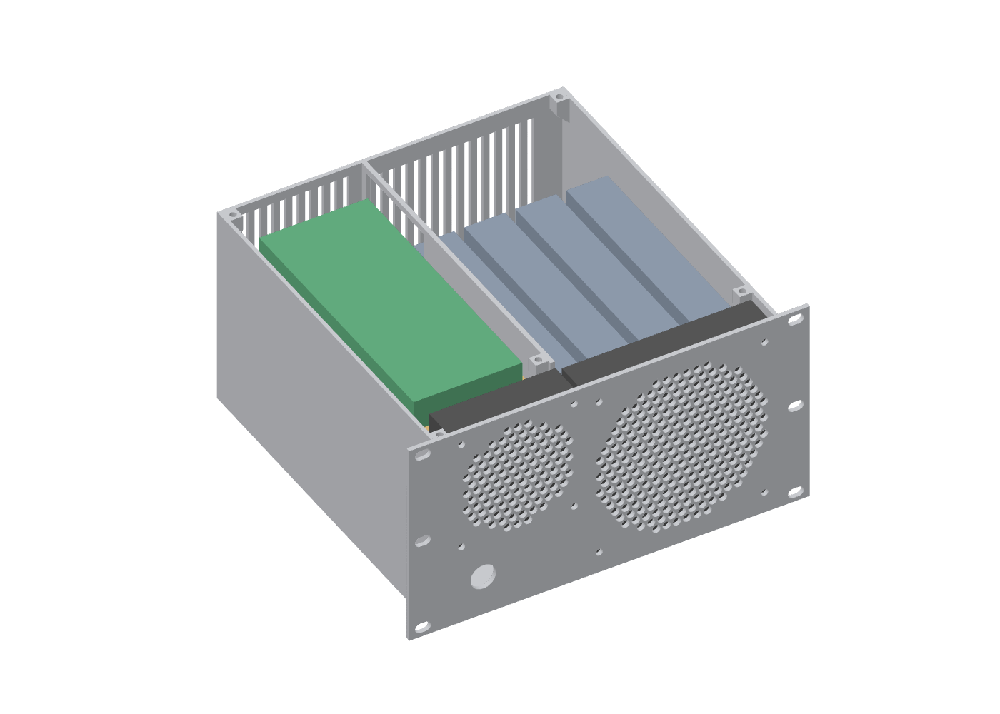
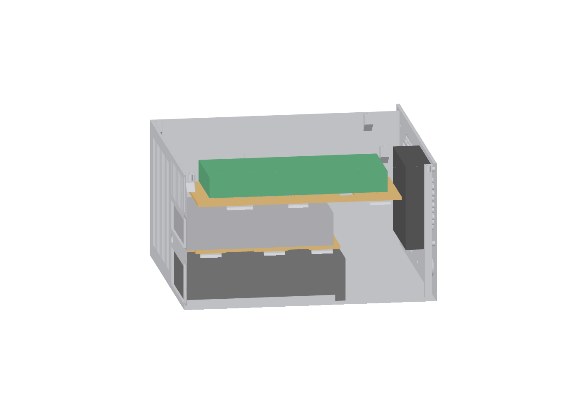
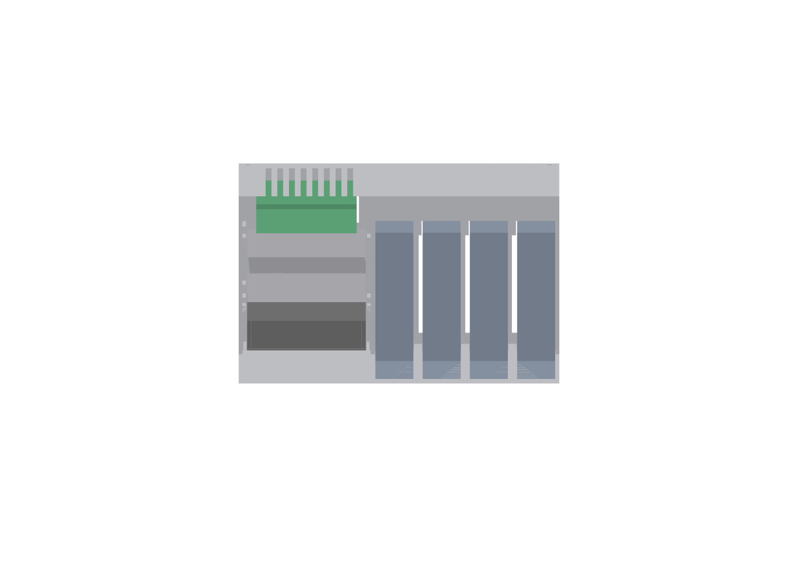

# casaos rack case (10", 3U, 3D-printed)

A case for casaos's hardware: a **ZimaBoard 832** (confirmed with `dmidecode` on 2026-11-16), a SAS HBA
(not bought yet), the 2 current 3.5" SATA drives and 2 planned 3.5" SAS drives. It goes in the same
**Lab Rax 10" 5U** printable rack as the homelab-notebook's 1U case, filling 3 of the 4 free U.
Status: **designed, not printed**.

It is deliberately simpler than the notebook case: everything is a box (no traced boards, no RJ45
hood), built by one Python script with `manifold3d` instead of Blender.

```
pip install manifold3d trimesh numpy scipy
python3 build_case.py      # out/*.stl, out/assembly.glb, out/dimensions.txt; prints a clearance check
node render.mjs            # out/*.png from assembly.glb (Playwright + three.js from jsDelivr)
                           # in a cloud session: NODE_PATH=/opt/node-tools/node_modules node render.mjs
```
`build_case.py` checks that no part or component overlaps another. It also sweeps the PSU, the shelves
and the drives along their assembly paths to check they can go in. It must print `clearance check: OK`.



## Layout

Seen from the front: a **column** on the west (left) side, 88 mm wide, then a divider, then the
**drive cage** (124 mm wide).

| Where | What |
|---|---|
| Cage | 4 identical 3.5" slots. Drives stand on their long edge between 12 mm floor ribs, connectors at the rear, and drop in from the top. A floor bar stops them at the front. Two comb bars under the lid hold them down. 26.7 mm slots, 5.7 mm between drives. |
| Front of the cage | 120 mm intake fan (in the panel) blowing along all four drives, out the rear-wall grille |
| Behind the drives | 49.7 mm for SATA/SAS connectors and cable bends |
| Column, floor, rear | Flex-ATX ("1U") PSU, 81.5 × 40.5 × 150 mm. Its IEC inlet + fan go through a rear-wall window, and the wall rim stops it sliding out. Floor rails hold its sides. A 5 mm floor stop holds the front. |
| Column, over the PSU | 10 mm cable channel, then the **board shelf**: the ZimaBoard lies on it, its I/O end through a rear-wall window, held with a hook-and-loop strap |
| Column, top | **HBA shelf**: the card lies flat on pads, held with a hook-and-loop strap, and connects through a PCIe riser cable via a slot in front of the board |
| Front of the column | 80 mm intake fan across both shelves; 16 mm latching power button (wired to the PSU's PS_ON) |
| Lid | 5 × M3 screws into heat-set inserts; vent slots over the column; drive comb bars underneath |

 

**Why a riser:** the ZimaBoard's PCIe x4 slot is in line with the board, so a card plugged in directly
sticks straight out, ~300 mm overall. That fits neither way in a 10" rack.

**Why a Flex-ATX PSU:** the ZimaBoard's own 12 V barrel jack can't spin up 4 × 7200 rpm 3.5" drives
(~2 A @ 12 V each at spin-up). Flex-ATX is the only standard PSU that fits the 88 mm column under the
board. It also powers the ZimaBoard (12 V, through a barrel cable) and both fans.

## Assembly order

1. **PSU:** lower it in ~44 mm forward of its final spot, which keeps it clear of the rear-west lid
   boss. Lift its front over the 5 mm stop and slide it back against the rear wall.
2. **Cables:** run the PSU cables back over the PSU, through the 10 mm channel, and into the drive
   area through the divider's rear window (Y 165–229).
3. **Board shelf:** drop it straight in. Its side notches clear the upper ledges, and it rests on the
   lower ones. Then put the ZimaBoard on it, I/O end to the rear wall.
4. **DC cable:** the ZimaBoard's DC jack is on its I/O end, outside the wall. Plug the barrel in from
   outside, and run its cable back in through the 9 mm hole under the board window.
5. **HBA shelf** (rests on the upper ledges), the riser, then the card.
6. **Drives:** drop them into the slots, connectors to the rear.
7. **Lid.**

## Parts

| Print | Size | Notes |
|---|---|---|
| `out/tray.stl` | 254 × 238 × 133 mm, ~530 cm³ | Needs a 256 mm bed (same footprint as the notebook tray). It prints on its floor, and the lid bosses/ledges have 45° chamfers. |
| `out/lid.stl` | 220 × 235 × 37 mm | Exported upside down, combs up |
| `out/board_shelf.stl`, `out/hba_shelf.stl` | 87 mm wide | Flat |
| `rear_bracket_left/right.stl` | | **Reuse the notebook's** from [../../../homelab-notebook/hardware/case/out/](../../../homelab-notebook/hardware/case/out/). Same rack, same depth (235.2 mm behind the panel), and the 3U panel keeps the same 0.395 mm offset above its U. Bolt them at this case's bottom U. |

Material: **PETG or ASA, not PLA**. Loaded weight is ~5 kg (4 drives ≈ 2.8 kg + PSU), and PLA creeps.
Like the notebook case, it needs the rear brackets: front ears alone aren't enough.

### To buy
- Flex-ATX PSU, 250–300 W, with ≥ 4 SATA power connectors (or Molex + adapters)
- SAS HBA in IT mode, low-profile (LSI 9207-8i / 9211-8i class). They run hot: zip-tie a 40 mm fan to the heatsink.
- PCIe x4 **flexible riser cable** (~20 cm), with an open-ended x16 socket or one sized to the card (x8)
- SFF-8087 → 4 × SFF-8482 breakout cable. SFF-8482 connectors take SATA drives too, and each carries its drive's power.
- 120 × 25 mm and 80 × 25 mm 12 V fans (Molex/SATA-powered or via adapters)
- 16 mm latching push button, wired between PS_ON (green) and GND on the 24-pin
- DC barrel cable from the PSU's 12 V (Molex) to the ZimaBoard. The board takes 12 V/3 A. **Check the plug size on the board (believed 5.5 × 2.5 mm).**
- 5 × M3 heat-set inserts (4.0 mm hole, 6.5 mm deep) + M3 × 6 screws; 6 × M6 rack screws (front) + the notebook brackets' M6 bolts; hook-and-loop straps (slots are 3 × 22 mm)

## Unverified — measure before printing

- **ZimaBoard 832 envelope 138.7 × 81.4 × 31 mm** is from the spec sheet, not measured. Its rear-wall
  window assumes the I/O ports span the full end face with 2 mm margins.
- **The PCIe slot position** (assumed at the end opposite the I/O) only affects the riser slot in the HBA shelf.
- **HBA envelope 168 × 69 × 20 mm** (generic low-profile card). Recheck it once the card is chosen.
  Pads + strap mean any LP card fits, but a full-height bracket must come off.
- **Flex-ATX PSUs vary.** Check that the IEC inlet and fan grille sit within the 76 × 36 mm rear window,
  and where its fan intake is.
- **Airflow is untested.** The drives have ~5 mm gaps between them, so check temperatures after building.

All key positions are in [out/dimensions.txt](out/dimensions.txt).
