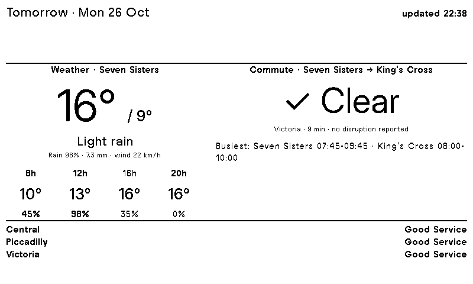

# Morning Board (Terminus extension id 1)

Poll extension rendered for model `og_plus` (id 12), rebuilt **every 10 min**, on device 7's
playlist (id 4) as its only item. Source of truth for re-creating it: `extension.json`,
`exchanges.json` (order matters — each becomes `source_N` in id order), `template.liquid`.

| source | exchange | what |
|---|---|---|
| source_1 | Open-Meteo forecast, lat 51.5829 lon -0.0733 (Seven Sisters stn), 2 days | weather |
| source_2 | TfL `/Line/victoria,piccadilly,central/Status` | live line status |
| source_3 | TfL Journey Planner 940GZZLUSVS → 940GZZLUKSX, tube; for tomorrow `date=…&time=0830` | commute legs, duration, disruptions |
| source_4 | TfL line status for window now → end of target day | planned works / strikes |
| source_5 | TfL `/crowding/940GZZLUSVS/<Ddd>` | Seven Sisters peak window (no % published — all 0) |
| source_6 | TfL `/StopPoint/940GZZLUSVS,940GZZLUKSX/Disruption` | station closures / lifts |
| source_7 | TfL `/crowding/940GZZLUKSX/<Ddd>` | King's Cross peak window |

**Target day** = date of (now + 2 h): today until 21:59, tomorrow from 22:00. Used by the template
(weather index, header) and by the exchange URLs (journey date, planned-status window, crowding
weekday). Container TZ is Europe/London, so Liquid `"now"` is local time.

**Commute verdict**: "✓ Clear" unless any of: a disruption on a journey leg, planner routes via a
line other than Victoria, duration > 15 min (normal 9), Victoria non-Good status in the target-day
window, or a station disruption at either end → "⚠ Check" + up to 3 reasons. No API keys needed
(TfL anonymous rate limit is ample at 7 calls / 10 min).

## Editing
- API: `POST https://terminus.intern.dgmneto.com/login` with `op://Personal/Terminus` (login/password)
  → `access_token` (30 min) as `Authorization` header. `PATCH /api/extensions/1`.
- **Gotcha: every PATCH must include `"model_ids":[12]`** — a PATCH without it clears the build
  matrix and scheduled builds silently render nothing (bit us 2026-10-25).
- No API to build or to manage playlist items. Force a build:
  `echo 'Terminus::Jobs::Extensions::Screen.new.perform(1, 12)' | docker exec -i terminus bundle exec hanami console`
  (or the Build button in the UI). Playlist items: UI, or `repositories.playlist_item` in the console.
- Dry-render with fake data (no stored changes): in the console, build the context with
  `aspects.extensions.contextualizer` + `Exchanges::Coalescer.call(repositories.extension_exchange.where(extension_id: 1))`,
  mutate it, render with `Hanami.app["superfluid.default"].call(template, ctx)`.
- Layout: TRMNL framework `flex--between` doesn't apply here; use inline `display:flex; justify-content:space-between`.
- Liquid: filters chain left-to-right — `issues | append: x | truncate: n` truncates the *whole*
  accumulator; truncate into a temp var first.
