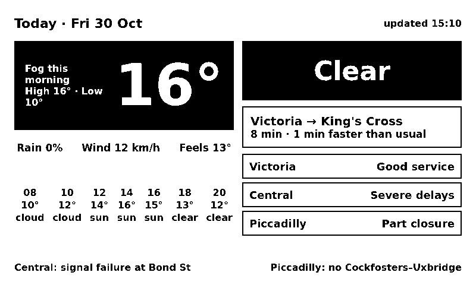

# trmnl-ai — LLM-designed TRMNL screen ("AI Board")



Small Python container on **casaos** that fetches weather + TfL data, asks an LLM via **OpenRouter**
to design the whole TRMNL screen as HTML, and serves it to Terminus. Terminus renders it to PNG for
device 7 through poll extension **2 "AI Board"** (screen 6) — **on device 7's playlist since
2026-10-30** (playlist 4, item 5). The fixed-layout Liquid
[Morning Board](../terminus/extensions/morning_board/README.md) (extension 1) is the backup.

```
trmnl-ai (172.21.0.141, no host port)                        Terminus (casaos)
 every 5 min: Open-Meteo + 6 TfL calls → trimmed JSON ──┐
 regen if data hash changed (≥20 min apart) or >60 min ─┤→ OpenRouter → HTML → validate
 GET :8080/screen.json  {html, generated_at, model} ◄───┴── extension 2 polls every 10 min,
                                                           template = <div class="{{extension.css_classes}}">{{ source_1.html }}</div>
```

## Where things are
- Server: `/home/dgmneto/homelab/services/trmnl-ai/` (`compose.yaml`, `app.py`, `prompt.md`,
  `env.tpl`, `.env` 600 gitignored, `create_extension.rb`). Data: `/footage/services/trmnl-ai/data`
  (owned uid 1000 — the container runs as 1000): `screen.json`, `last_data.json` (what the LLM saw),
  `last_raw.txt` (raw LLM reply).
- Re-creation source (mirror, keep in sync): [src/](src/). **Edit on the server, then copy back here**
  (or edit here and `tar c … | ssh casaos 'sudo -u dgmneto tar x -C …'`).
- Image `python:3.13-slim-bookworm`, stdlib only (no pip), watchtower **disabled**, 256 MB limit.
  The whole service dir is mounted at `/app` (ro) — see gotcha on single-file mounts.
- Endpoints (internalNetwork only): `/screen.json`, `/data.json` (last fetched data), `/preview`
  (HTML wrapped in an 800×480 `.screen` with plugins.css, red outline — for browser debugging).

## Data sources (no API keys)
Open-Meteo (Seven Sisters 51.5829,-0.0733: now, 2 days, target-day every 2 h 06–22), TfL line status
now + planned window now→end of target day (victoria, piccadilly, central), Journey Planner
940GZZLUSVS→940GZZLUKSX (tomorrow 08:30 after 22:00), StopPoint disruptions both stations, crowding
peak bands. **Target day** = date of now+2 h (rolls to tomorrow at 22:00), same as Morning Board.
A failing source becomes `{"error": …}` in the data; the prompt says to show "—". Adding a source =
add a function + entry in `collect()` in `app.py` and mention it in `prompt.md`.

## LLM / cost
- `OPENROUTER_MODEL` in `.env` (default `anthropic/claude-haiku-5.5`, $0.1/$0.5 per M tokens on
  2026-10-30; `anthropic/claude-sonnet-5.5` is $2/$10). Measured: ~3.9k tokens in + 3.5–5k out
  = **~$0.002–0.003 per call** on Haiku, ~6 s.
  The previous screen's HTML is sent along ("keep its layout") so the design stays stable between
  runs; `--fresh` omits it. Calls are gated: data hash change (ignores the clock/hourly temps) at most every `MIN_GAP`=20 min,
  forced every `MAX_AGE`=60 min, none during `QUIET_HOURS`=0-6 → ≲ 25 calls/day.
- Every call logs `in=… out=… cost=$…` (`docker logs trmnl-ai`).
- Key: 1Password **`Homelab/OpenRouter - TRMNL`** (field `credential`) → `.env` via `env.tpl`.
  Render from the Mac (cloud sessions have no `op`):
  ```
  ssh casaos 'cat /home/dgmneto/homelab/services/trmnl-ai/env.tpl' | op inject | ssh casaos 'sudo -u dgmneto sh -c "umask 077; cat > /home/dgmneto/homelab/services/trmnl-ai/.env"'
  ssh casaos 'cd /home/dgmneto/homelab/services/trmnl-ai && sudo -u dgmneto docker compose up -d --force-recreate'
  ```
  `env_file` is read at container create → a key change needs `up -d --force-recreate`, not `restart`.

## Choosing a model (bake-off 2026-10-30)
Same data snapshot (12:11, Piccadilly part closure), current prompt, one sample each, rendered by
Terminus as throwaway screens. Cost = OpenRouter-reported per screen; ≈ ×25/day.

| Model | $/screen | Result |
|---|---|---|
| `anthropic/claude-haiku-5.5` | 0.0024 | fits, clean, sensible priorities — **cheapest that passes** |
| `openai/gpt-6-luna` | 0.0019 | crowding line clipped at right edge, busy |
| `deepseek/deepseek-v4.1-flash` | 0.0032 | overlapping text in tube list — fail |
| `google/gemini-3.8-flash` | 0.0167 | fits, most polished boxed layout — best mid-price |
| `openai/gpt-6.1-terra` | 0.0153 | strong headline banner but weather text clipped |
| `anthropic/claude-sonnet-5.5` | 0.0495 | best overall polish/hierarchy, fits perfectly |
| minimax-m3.1-flash, mistral-large-4-0, glm-5.3-flash, qwen3.8-flash | — | hit 8000 max_tokens without finishing (no valid HTML) |

Finalists shown to the user: Haiku 5.5, Gemini 3.8 Flash, Sonnet 5.5. Rerun with
`src/bakeoff/bakeoff.py` (models as args) then `src/bakeoff/render.rb` (copy the HTML into the
terminus container's `/tmp/bakeoff/` first); delete the `bakeoff_*` screens afterwards.

## Iterating on the design (user feedback loop)
1. Add the feedback as a rule under **"User feedback"** at the bottom of `prompt.md` (on the server;
   it is re-read every call, no restart).
2. Regenerate + rebuild now instead of waiting (`--fresh` after a layout change, so the model
   doesn't just copy the previous screen):
   ```
   ssh casaos 'docker exec trmnl-ai python /app/app.py --once --force --fresh &&
     echo "Terminus::Jobs::Extensions::Screen.new.perform(2, 12)" | docker exec -i terminus bundle exec hanami console >/dev/null'
   ```
3. Look at the PNG: `select image_data->>'id' from screen where extension_id=2` →
   `sudo find /footage/services/terminus/uploads -name <id>` → copy it out and view it.
4. Copy `prompt.md` back to `src/`, log it, commit both repos.
Test a scenario without waiting for a real strike: write a fixture (start from `/data/last_data.json`)
and `docker exec trmnl-ai python /app/app.py --once --force --data /data/fixture.json`.

## Validation / failure behaviour
Reply must contain `view--full`, no `<script`, no external `src/href`/`url(http`, ≤40 KB; on reject
the model gets one retry with the reason. LLM error or double reject → previous `screen.json` kept.
With no key and no previous screen → deterministic fallback (date + line statuses, "AI screen
unavailable — fallback").

## Gotchas
- **Single-file bind mounts pin the inode.** The first compose mounted `./prompt.md` and `./app.py`
  as files; replacing them (tar, `sed -i`, editors) left the container reading the OLD prompt
  (spotted because `in=` tokens didn't change after a prompt edit). Now the dir is mounted. Check:
  `docker exec trmnl-ai grep -c '<new rule text>' /app/prompt.md`.
- **2-bit thresholding destroys thin/small/gray text** (first renders had broken glyphs): prompt now
  requires black text only, ≥16 px, weight ≥600 under 24 px.
- **The LLM cannot measure its layout.** Without a rule it overflowed right/bottom (cut-off hourly
  strip). The prompt forces a fixed 800×480 root and explicit per-section pixel heights summing to
  ≤456. There is no automated overflow check yet — always view the PNG after a prompt change.
  (Possible later fix: render-check with headless Chromium and retry.)
- **Rows collapse to content width**: the Terminus layout centers the body, and framework `layout`
  containers shrink children — every full-width row needs `width:100%` (now in the prompt).
- Terminus Liquid does **not** HTML-escape `{{ source_1.html }}` — that is what makes this work.
- `/home/dgmneto/homelab` is mode 750 to other users: as `claude`, run things with
  `sudo -u dgmneto sh -c "cd … && …"` (plain `cd` → Permission denied).
- Extension 2 was created with `hanami console` (`src/create_extension.rb`), not the API — no
  Terminus login needed. It has `extension_model` (2,12); keep `model_ids:[12]` on any API PATCH.

## Rollback to Morning Board
The swap was done in SQL: `update playlist_item set screen_id=6 where id=5` (was 5). Roll back:
`docker exec terminus-db psql -U terminus -d terminus -c "update playlist_item set screen_id=5, updated_at=now() where id=5"`
(or Terminus UI → Playlists → device_7). Stop the generator:
`sudo -u dgmneto sh -c "cd /home/dgmneto/homelab/services/trmnl-ai && docker compose stop"`.
